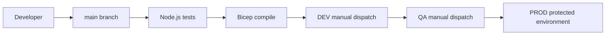
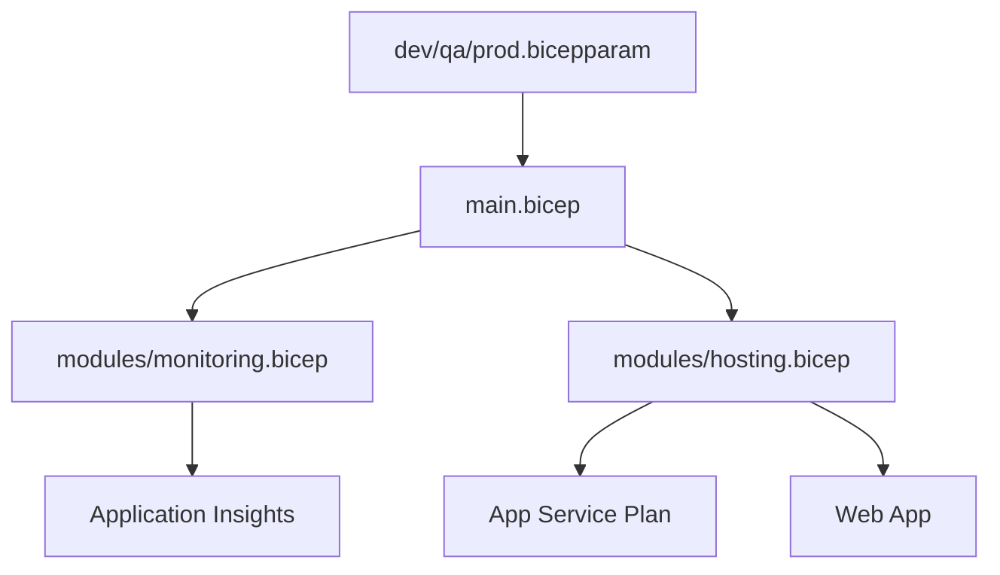

# Architecture diagrams

```mermaid
flowchart TD
  Git[GitHub Repository] --> CI[GitHub Actions: Test and Bicep Build]
  CI --> Gate{Manual workflow dispatch + environment approval}
  Gate --> OIDC[Azure OIDC Federated Identity]
  OIDC --> Bicep[main.bicep]
  Bicep --> AI[Application Insights]
  Bicep --> Plan[Linux App Service Plan]
  Plan --> Web[Node.js Web App]
  AI -. telemetry .-> Web
  CI --> Zip[ZIP Deploy]
  Zip --> Web
  Web --> Health[/health endpoint]
```




